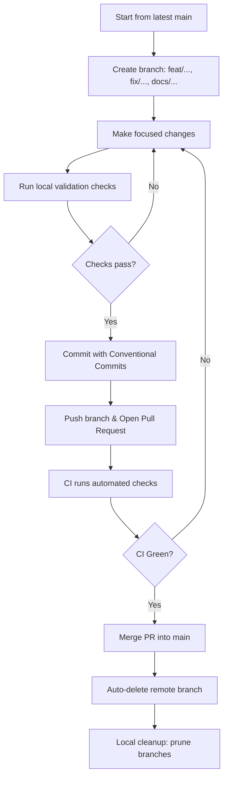

# Contributing to SKILLS

Thank you for contributing to `SKILLS`! This repository is a portable library of agent skills designed for both human maintainers and autonomous coding agents.

---

## 1. Branching Strategy (GitHub Flow)

All contributions must follow a lightweight, short-lived branch workflow based on GitHub Flow:

1. **Branch off `main`**: Always ensure your local `main` is up to date before branching.
2. **Short-lived branches**: Branches should focus on a single task, feature, or fix and be merged promptly.
3. **Branch naming conventions**:
   * `feat/<topic>` — New skills, bundles, or installer features (e.g. `feat/quant-rsi`).
   * `fix/<topic>` — Bug fixes, broken links, or schema corrections (e.g. `fix/markdown-links`).
   * `docs/<topic>` — Documentation improvements and guides (e.g. `docs/runtime-guide`).
   * `chore/<topic>` — Maintenance, CI/CD updates, or tooling cleanup (e.g. `chore/ci-optimize`).

---

## 2. Contribution Workflow



---

## 3. Pre-PR Verification Commands

Before opening a PR, run the required local checks to ensure CI will pass:

```bash
# 1. Validate skill structure and frontmatter metadata
python3 scripts/validate_skills.py

# 2. Check generated skill index freshness
python3 scripts/generate_skill_index.py --check

# 3. Check local Markdown links
python3 scripts/check_markdown_links.py

# 4. Run test suites
pytest -q
python3 -m unittest discover -s tests -p 'test_*.py'

# 5. Check for whitespace errors
git diff --check
```

If you modified any skill frontmatter, update the generated index first before checking:
```bash
python3 scripts/generate_skill_index.py
```

---

## 4. Commit Conventions

Follow [Conventional Commits](https://www.conventionalcommits.org/):
* `feat:` introducing a new skill, bundle, or feature.
* `fix:` fixing a defect, broken link, or validation failure.
* `docs:` documentation-only changes.
* `chore:` maintenance, dependency updates, CI configurations.
* `refactor:` code restructuring without changing behavior.

Keep commits focused, reviewable, and atomic. Avoid large grab-bag commits.

---

## 5. Agent Reporting and PR Handoff Contract

When an AI agent (Antigravity, Codex, Claude Code, OpenCode, etc.) completes work and opens or prepares a Pull Request:

* **Mandatory PR Link**: The final report **must include a direct, clickable PR link** (for example: `https://github.com/ryantr-statinops/SKILLS/pull/<number>`).
* **Summary of Changes**: The agent must outline the changed files, validation checks run, and instructions for the maintainer to review and merge with 1 click.
