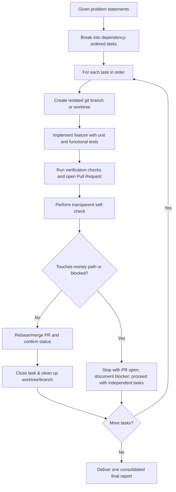

# Solo Pipeline

Problems go in; one agent turns them into discrete, dependency-ordered tasks and takes each through development, testing, PR creation, transparent self-check, and merge or explicit blocker escalation. One consolidated report is delivered at the end.

## Workflow at a glance



## Core Principles

1. **Strictly Solo:** One agent owns the entire pipeline from end to end. Do not spawn subagents, bots, or delegate tasks.
2. **Transparent Self-Check:** The check before each merge is an author self-check, **not an independent review**. Never post fabricated reviewer verdicts (e.g., no fake `Verdict: PASS` or `Approved by reviewer`). Clearly declare in PR descriptions: *"Merged based on author self-check; no independent review performed"*.
3. **Money-Path Safety Boundary:** Any change touching financial calculations, orders, fills, account balances, P&L, or sensitive transaction paths is high risk. The agent implements and opens the PR, but **must never self-merge**; the PR must remain open for human review.
4. **Worktree / Branch Isolation:** Each task is developed in its own branch or worktree based on the latest `main`, ensuring no dirty uncommitted state leaks between tasks.

---

## When to use

Use when explicitly requested to autonomously solve a set of issues or problem statements end-to-end as a single agent through branch creation, implementation, testing, PR opening, and safe self-merging.

## When not to use

* Do not use when the user requests multi-agent orchestration, human-in-the-loop pair programming, or supervised worker delegation (use `personal/workflow/orca-orchestration`).
* Do not use for simple single-file edits or direct advice where an elaborate issue/worktree pipeline adds unnecessary overhead.
* Do not use on projects that strictly forbid self-merging by policy; in such cases, open the PR and stop.

---

## Procedure

### 1. Problem Decomposition and Dependency Ordering

* Analyze the given problem statements.
* Break them down into discrete, reviewable work packages.
* Identify dependencies between tasks. Sort tasks into a strict dependency execution list where dependent tasks wait for upstream merges.
* Flag any task touching financial paths or core business invariants as `risk:money-path`.

### 2. Isolated Workspace & Implementation

For each task in dependency order:
* Ensure upstream dependencies are merged into `main`.
* Create a dedicated git branch or worktree from latest `main`:
  ```bash
  git checkout main && git pull origin main
  git checkout -b <task-id>/<slug>
  ```
  *(Or using `git worktree add ../<task-id> -b <task-id>/<slug>` when directory isolation is preferred).*
* Implement the solution adhering to repository conventions:
  * Write unit tests covering domain logic.
  * Write functional/integration tests validating the end-to-end task outcome.
  * Keep changes strictly within task-owned files.

### 3. Verification & Pull Request

* Run local test suites and linters.
* Check for clean whitespace and diff: `git diff --check`.
* Commit changes using Conventional Commits (`feat:`, `fix:`, `docs:`).
* Push the branch and open a Pull Request using `gh pr create`:
  * Explicitly note: **"Merged based on author self-check; no independent review performed"**.
  * Reference any related issues (e.g. `Closes #<id>`).
* Monitor CI checks: `gh pr checks <pr-number>`. If CI fails, diagnose and fix on the branch.

### 4. Transparent Self-Check & Merge

Evaluate the PR against merge criteria:
1. **Author Verification:** You alone authored the changes on this branch.
2. **Not a Money Path:** The diff touches no financial transactions, order execution, balances, risk limits, or critical business invariants.
3. **Green CI & Clean Checks:** All automated tests, linters, and validations exit with code 0.
4. **No Unresolved Feedback:** No conflicting changes or human hold requests on the PR.

If all criteria hold:
* Merge the PR:
  ```bash
  gh pr merge <pr-number> --rebase
  ```
* Verify merge completion: `gh pr view <pr-number> --json state`.
* Switch back to `main`, pull latest, and remove the feature branch or worktree:
  ```bash
  git checkout main && git pull origin main
  git branch -d <task-id>/<slug>
  ```

### 5. Escalation & Blocking States

Stop and keep the PR open when:
* The task touches a **money path** (`risk:money-path`).
* CI fails and cannot be resolved within the scope of the task.
* A rebase conflict occurs that cannot be cleanly resolved without broader architectural decisions.
* Ambiguity requires clarification from the user.

When stopped:
* Push current commits, ensure PR is open, and add a comment outlining the blocker and required human action.
* Leave the branch and PR open.
* Move on to subsequent independent tasks that do not depend on this blocked task.

### 6. Consolidated Final Report

Deliver a single comprehensive report at the end covering:
* All tasks processed, in order.
* For each merged task: PR link, commit hash, and tests verified.
* For each blocked/money-path task: PR link, reason left open, and required human intervention.
* Explicit statement reaffirming: *"All merges were completed under author self-check without independent review."*
